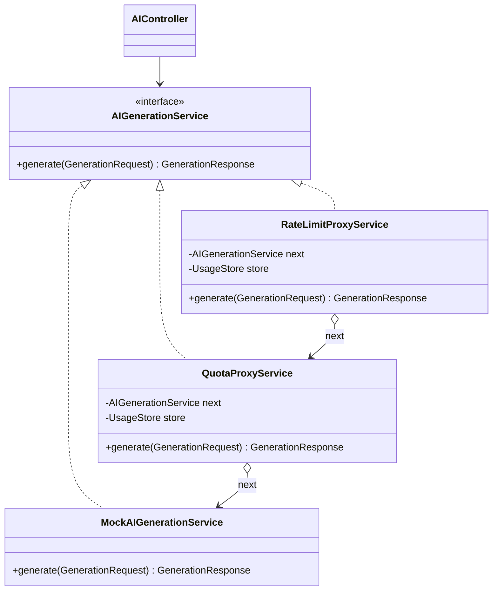

# Plataforma de consumo de IA con Proxy de rate limiting y cuotas

Taller Patrón Proxy · Backend **Spring Boot 3 (Java 17)** + Frontend **React (Vite)**

## 1. Patrón Proxy aplicado

| Rol del patrón | Clase |
|---|---|
| **Subject** | `AIGenerationService` (interfaz `generate(GenerationRequest): GenerationResponse`) |
| **RealSubject** | `MockAIGenerationService` (`Thread.sleep(1200)` + texto predefinido aleatorio) |
| **Proxy 1** | `RateLimitProxyService` → 429 Too Many Requests + header `Retry-After` |
| **Proxy 2** | `QuotaProxyService` → 402 Payment Required; descuenta tokens tras la respuesta |
| **Client** | `AIController` (solo conoce la interfaz, no sabe que hay proxies) |
| Ensamblado de la cadena | `ServiceChainConfig` |



Flujo: `request → RateLimitProxy → QuotaProxy → MockAIGenerationService`.
Si un proxy bloquea, **el servicio real nunca se ejecuta** (lo verifican los tests).

**Por qué Proxy (y principios GRASP/SOLID):**
- *Bajo acoplamiento / Polimorfismo*: el controlador depende solo de la interfaz; se pueden añadir, quitar o reordenar proxies sin tocarlo.
- *Alta cohesión / Responsabilidad única*: cada proxy tiene una sola responsabilidad (frecuencia vs. consumo).
- *Abierto/Cerrado*: el servicio real no se modificó para agregar control de acceso.
- *Experto en información*: `UsageStore` posee los datos de consumo y es quien los calcula.

## 2. Planes

| Plan | Requests/min | Tokens/mes |
|---|---|---|
| FREE | 10 | 50.000 |
| PRO | 60 | 500.000 |
| ENTERPRISE | ilimitado | ilimitado |

## 3. Estructura del backend

```
com.taller.proxy
├── controller   AIController, QuotaController
├── proxy        RateLimitProxyService, QuotaProxyService
├── service      AIGenerationService, MockAIGenerationService, TokenEstimator
├── store        UsageStore (estado en memoria, thread-safe)
├── model        Plan
├── dto          GenerationRequest/Response, QuotaStatus, DailyUsage...
├── exception    RateLimitExceededException, QuotaExceededException, GlobalExceptionHandler
├── config       ServiceChainConfig (arma la cadena), CorsConfig
└── scheduler    ResetScheduler (@Scheduled)
```

## 4. Endpoints (usuario identificado por el header `X-User-Id`)

| Método | Ruta | Descripción |
|---|---|---|
| POST | `/api/ai/generate` | Body `{"prompt":"..."}`. Pasa por la cadena completa de proxies |
| GET | `/api/quota/status` | tokens usados, restantes, resetDate, plan actual |
| GET | `/api/quota/history` | uso diario de los últimos 7 días |
| POST | `/api/quota/upgrade` | Body `{"plan":"PRO"}` (por defecto FREE → PRO) |
| POST | `/api/quota/demo/exhaust` | *Solo demo:* agota la cuota para mostrar el 402 |

Tareas programadas (`ResetScheduler`): rate limit cada minuto (`0 * * * * *`) y cuota mensual el día 1 (`0 0 0 1 * *`).

## 5. Tests

`ProxyChainTest` (9 pruebas unitarias, sin Spring): request válida, bloqueo en la request 11 con Retry-After,
reset del minuto, cuota agotada sin llamar al servicio real, orden RateLimit → Quota, upgrade, no downgrade,
ENTERPRISE ilimitado e historial de 7 días.

```bash
cd backend && mvn test
```

## 6. Ejecutar en local

```bash
cd backend && mvn spring-boot:run                                   # http://localhost:8080
cd frontend && cp .env.example .env && npm install && npm run dev   # http://localhost:5173
```

## 7. Despliegue

**Backend → Railway:** New Project → Deploy from GitHub → *Root Directory* `backend` (usa el `Dockerfile`)
→ Networking → *Generate Domain*. Variable `CORS_ORIGINS` = URL de Vercel.

**Frontend → Vercel:** Add New Project → *Root Directory* `frontend` → variable `VITE_API_URL` = URL de Railway (sin `/` final).

## 8. Guion de demo (2 minutos)

1. Enviar un prompt: el estimador muestra los tokens, la barra de cuota y el historial se actualizan.
2. Enviar 11 prompts seguidos (plan FREE): a la request 11 → **429**, el botón se deshabilita y aparece la cuenta regresiva.
3. Clic en **"Demo: agotar cuota mensual"** → se abre el **modal de upgrade** (402) → pago simulado → badge cambia a **PRO**.
